# Flute

A calm, text-first Android home screen that **understands your apps**. Flute sorts what you have installed into categories (Banking, Work, Chat, Social, Media, Games, Shopping, Travel, Tools), lets you switch between **modes** that decide what is shown or paused, and puts a small animated companion on the home screen that follows the weather and your bedtime.

[](https://github.com/igun997/flute-launcher/actions/workflows/nightly.yml)
[](https://github.com/igun997/flute-launcher/releases/latest)
[](LICENSE)

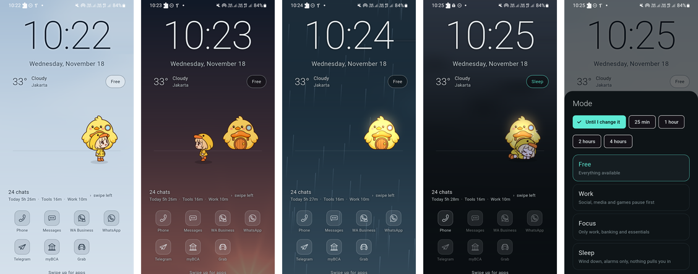

> Flutter UI with a small Kotlin layer. Android 7.0+ (API 24). English only. No account, no ads, no analytics.

## Download

| Channel | What it is | Get it |
|---|---|---|
| **Release** | Tagged, tested builds. Use this one. | [Latest release](https://github.com/igun997/flute-launcher/releases/latest) |
| **Nightly** | Latest commit on `main`, rebuilt on every push. May be unstable. | [Nightly pre-release](https://github.com/igun997/flute-launcher/releases/tag/nightly) |

Both are **release builds signed with the same Flute key**, so they update over each other without uninstalling. Android never installs an older build over a newer one, so to go from a nightly back to an older release, uninstall first.

### Install

1. Download `flute-<version>-arm64-v8a.apk` on your phone. It fits almost every phone made since 2017. For another CPU, [build it yourself](#build-it-yourself).
2. Open it and allow **Install unknown apps** for your browser or file manager when Android asks.
3. Press Home and choose **Flute** as your default home app (Settings → Apps → Default apps → Home app).
4. Open Flute → long-press the home screen → **Settings** and switch on what you want. Each permission is optional and explained in the app.

Verify the download (optional, recommended). Every release ships a `.sha256` file, and the signing certificate fingerprint is printed in the release notes.

```bash
sha256sum -c flute-0.1.0-arm64-v8a.apk.sha256
apksigner verify --print-certs flute-0.1.0-arm64-v8a.apk
```

The official signing certificate has this SHA-256 fingerprint:

```
3ea3728ed33224da4b49915df935e3b566413c91567161eb3c7834730190dd59
```

If `apksigner` prints a different value, the APK was not built by this project's CI.

## What it does

### Looks like the sky outside

A GPU shader draws the sky behind the home screen. It follows **sunrise and sunset** at your location and the **live weather** (clear, clouds, fog, drizzle, rain, thunderstorm, snow). Text switches to dark ink when the sky is bright so it always stays readable. In Settings → Appearance you can preview any time of day or weather for ten minutes.

<p>
  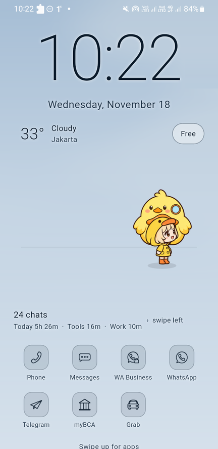
  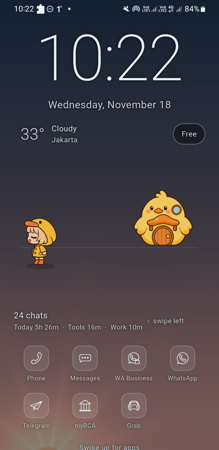
  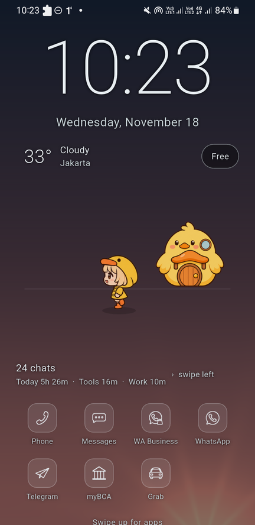
  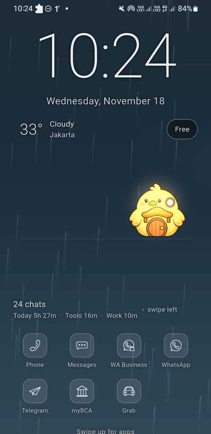
</p>

### A companion that lives on Home

Pick one of six original chibi characters in **Settings → Characters**. They stroll across the home screen, react when you tap them, **go into their little house when it rains** (the window glows), and **fall asleep outside the door at night** or in Sleep mode. Knock on the house to see who is inside.

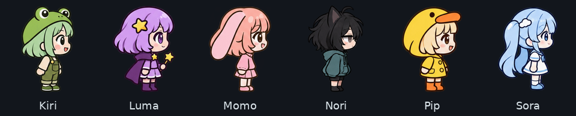

Characters are drawn with a single GPU `drawAtlas` call and only repaint when something visibly changes, so a pet standing still costs a few frames a second. Want your own? See [Add your own character](#add-your-own-character).

### Modes

Free, Work, Focus and Sleep. A mode decides which categories are shown, dimmed or paused. Start one manually, for a set time, or on a schedule. Opening a paused app shows a short pause screen first: wait, go back, or open anyway.

**Sleep** also turns on Do Not Disturb (alarms only; your previous setting returns when you wake up), darkens the sky and lets the companion go to bed.

<p>
  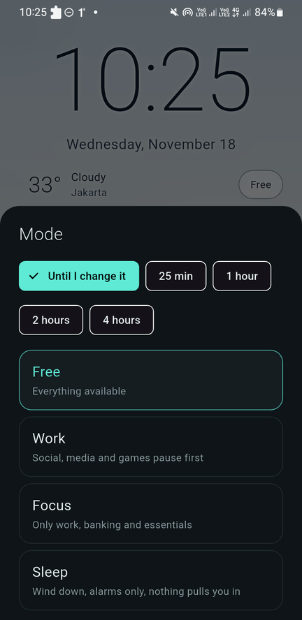
  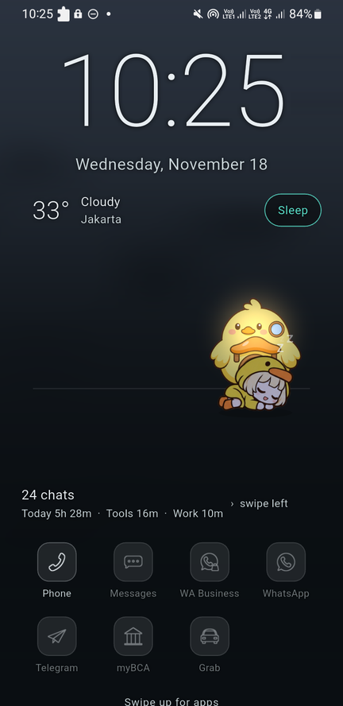
  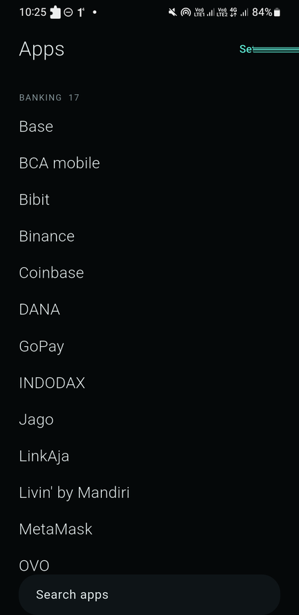
</p>

### Apps by category, text first

Swipe up for a plain text list grouped by category (Flute ships with 900+ known package names, and you can override any app). Search is built in. Pinned apps on Home get a redrawn line icon; everything else stays quiet and gray.

### One inbox

Swipe left on Home for **Inbox**: WhatsApp and SMS notifications (captured from your notifications, no SMS permission, nothing leaves the phone) and optional IMAP mail (Lark, Gmail, or any IMAP server; headers only). Unread counts show on Home.

### Lockscreen and gestures

- **Flute lockscreen** shows the clock, weather and message counts. Your PIN or fingerprint is still what unlocks the phone. Message previews are off by default.
- **Double-tap an empty spot on Home** to turn the screen off (needs the optional Flute lock service in Accessibility, which can only lock the screen).
- **Wave to wake**: cover the proximity sensor twice to wake the phone. A backup for a broken power button.

<p>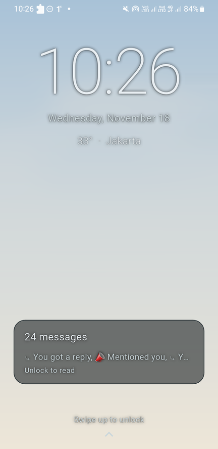 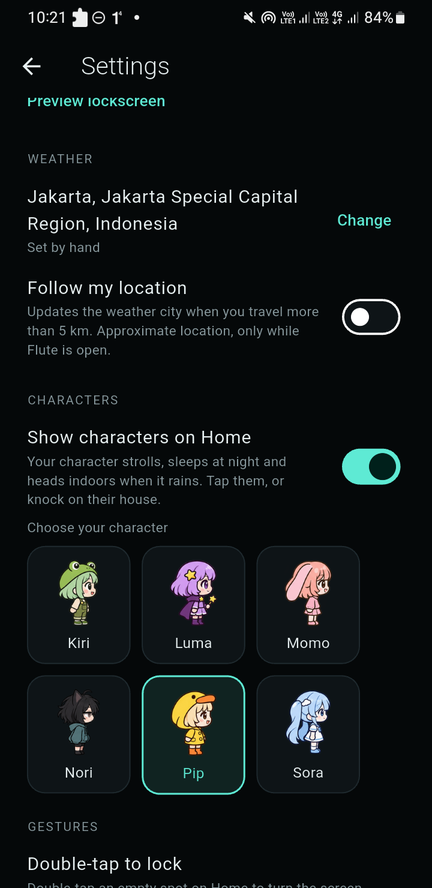</p>

### Weather where you are

Pick a city, or turn on **Follow my location**: Flute updates the city when you have moved more than 5 km. It uses approximate location only, only while Flute is open, and never asks on its own.

## Permissions

| Permission | Why | Needed for |
|---|---|---|
| Notification access | Read WhatsApp/SMS notifications | Inbox, lockscreen counts |
| Usage access | Time per category | "Today 4h" summary, pause screen |
| Display over other apps | Show the pause screen and lockscreen on top | Soft lock, lockscreen |
| Do Not Disturb access | Alarms-only while sleeping | Sleep mode |
| Accessibility (Flute lock service) | `GLOBAL_ACTION_LOCK_SCREEN` only | Double-tap to lock |
| Approximate location | Pick the weather city | Follow my location |
| Network | Weather (Open-Meteo), IMAP if you add mail | Weather, mail |

Everything is opt-in and off until you enable it. Flute reads no message bodies from mail, stores IMAP passwords in the Android keystore, and has no analytics or server of its own.

> **Samsung phones:** keep *One UI Home* enabled. Flute is your home app, but the Recents button is served by Samsung's launcher, and disabling it breaks Recents.

## Build it yourself

You need **Flutter (stable channel)**, **JDK 17** and the **Android SDK**. Check with `flutter doctor`.

```bash
git clone https://github.com/igun997/flute-launcher.git
cd flute-launcher
flutter pub get
flutter analyze && flutter test

flutter run                            # debug build on a connected phone
flutter build apk --release --target-platform android-arm64
# -> build/app/outputs/flutter-apk/app-release.apk
```

Other CPUs: use `--target-platform android-arm` (32-bit phones) or `android-x64` (emulators), or `--split-per-abi` for all of them. Only `arm64` is tested.

Without any signing setup the release APK is signed with your local **debug key**. It installs fine, but it is a different identity than the official builds, so Android will not update one over the other. Uninstall first when switching.

### Sign with your own key

Create a keystore once and keep it somewhere safe. **If you lose it you can never update the app for people who installed it.**

```bash
keytool -genkeypair -v -keystore ~/flute-release.jks -storetype PKCS12 \
  -alias flute -keyalg RSA -keysize 4096 -validity 36500
```

Create `android/key.properties` (it is git-ignored; never commit it):

```properties
storeFile=/home/you/flute-release.jks
storePassword=...
keyAlias=flute
keyPassword=...
```

`flutter build apk --release` now signs with that key. Print its fingerprint with
`keytool -list -v -keystore ~/flute-release.jks -alias flute`.

### Run the same pipeline on your own fork

The repository is built by GitHub Actions. To get signed nightly and release APKs on your fork:

1. **Fork** the repository and enable Actions on the fork.
2. Add these under *Settings → Secrets and variables → Actions → New repository secret*:

   | Secret | Value |
   |---|---|
   | `ANDROID_KEYSTORE_BASE64` | `base64 -w0 ~/flute-release.jks` (on macOS: `base64 -i ~/flute-release.jks`) |
   | `ANDROID_KEYSTORE_PASSWORD` | the keystore password |
   | `ANDROID_KEY_ALIAS` | `flute` |
   | `ANDROID_KEY_PASSWORD` | the key password |

   Or with the GitHub CLI:
   ```bash
   base64 -w0 ~/flute-release.jks | gh secret set ANDROID_KEYSTORE_BASE64
   gh secret set ANDROID_KEYSTORE_PASSWORD
   gh secret set ANDROID_KEY_ALIAS
   gh secret set ANDROID_KEY_PASSWORD
   ```
3. **Nightly:** push to `main`. The *Nightly* workflow analyzes, tests, builds, signs and replaces the `nightly` pre-release.
4. **Release:** tag a commit and push the tag.
   ```bash
   git tag v0.2.0 && git push origin v0.2.0
   ```
   The *Release* workflow builds from the tag (`v0.2.0` becomes version name `0.2.0`) and publishes a release with the APK and its checksum. Tags with a dash (`v0.2.0-rc1`) are marked pre-release.

Without the secrets, the workflows still run and produce debug-signed APKs. Secrets are only given to workflows that run on your own branches and tags; pull requests from forks use the plain *CI* workflow (analyze + test) and never see them.

The Android version code is the build time in minutes since 1970, so every build is newer than the last and installs over the previous one, nightly or release.

## Add your own character

A character is a folder of sprite strips plus an entry in an index file.

```
assets/pets/<id>/
  walk.png    idle.png    sleep.png    happy.png   4 frames each, 640×160 (4 cells of 160 px)
  house.png                                          256×256
assets/pets/index.json                               { "cell": 160, "houseCell": 256,
                                                       "pets": [ { "id": "...", "name": "...", "phrases": ["..."] } ] }
```

Draw characters facing **right**; Flute mirrors them. Add the folder to the `assets:` list in `pubspec.yaml` and rebuild. The character then shows up in Settings → Characters. `tools/make_pets_art.py` and `tools/cut_pets.py` show how the bundled characters were generated and cut (they need an image API key in `.env`, which is git-ignored).

Please only add characters you drew or have the right to use.

## Project layout

```
lib/core        categories, modes, app repository, day/sky styles
lib/home        home, apps, inbox, mode sheet, settings
lib/widgets     clock, weather chip, GPU sky, mode transitions, icons
lib/pets        companion simulation, sprites, stage
lib/weather     Open-Meteo client, location following
lib/email       IMAP inbox
lib/lock        lockscreen
android/app/src/main/kotlin   notification listener, lockscreen, DND, accessibility lock, wave to wake
shaders         sky, mode transition and window glow fragment shaders
docs/SPEC.md    architecture notes
```

## Contributing

Issues and pull requests are welcome. Run `flutter analyze` and `flutter test` before you open one; the *CI* workflow runs both on every pull request.

## License

[MIT](LICENSE). The bundled character art was generated with AI image models for this project and is released under the same license.
